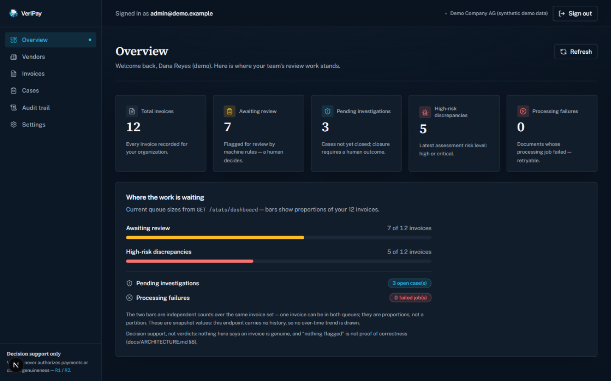
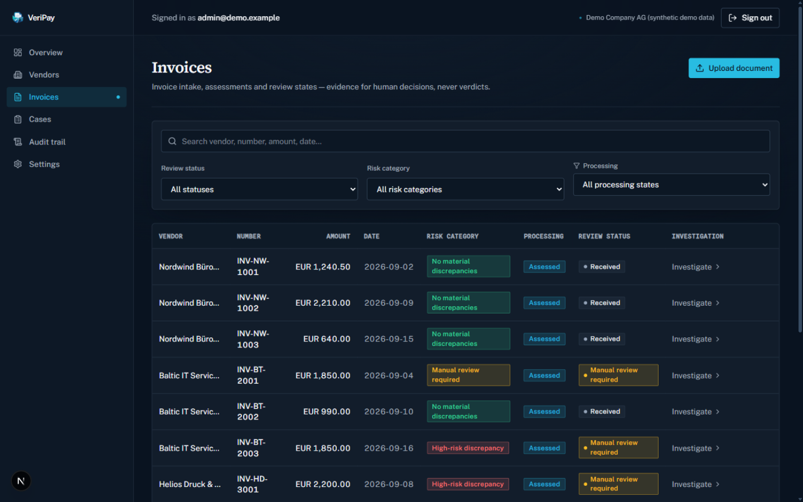
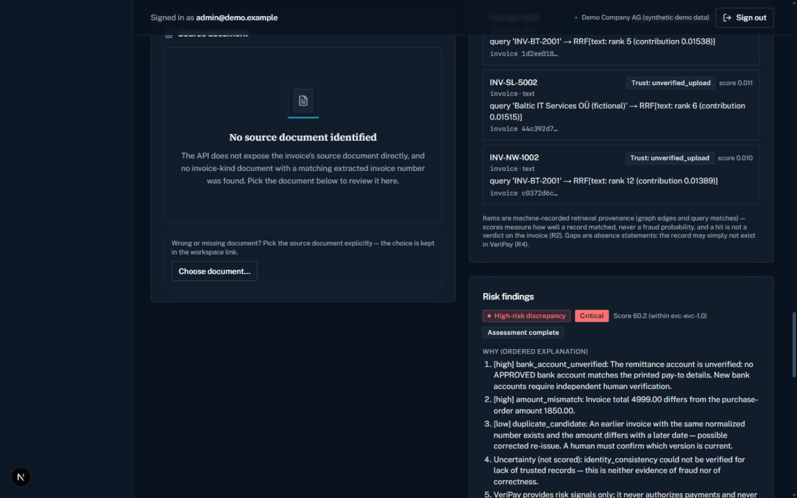
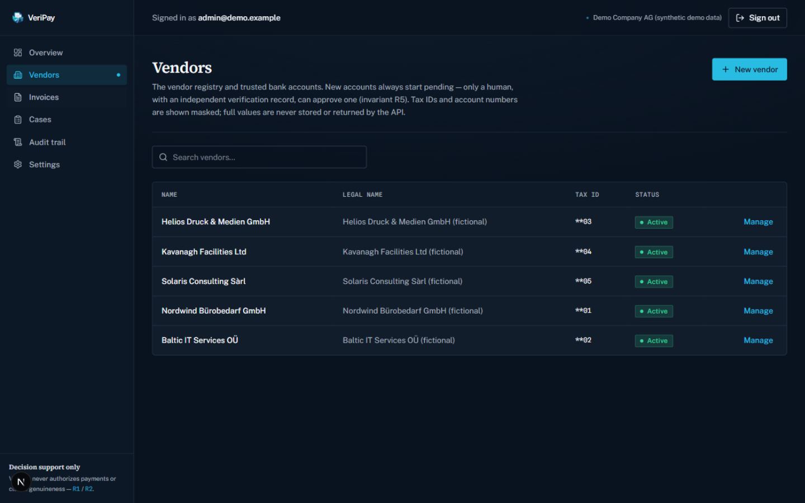
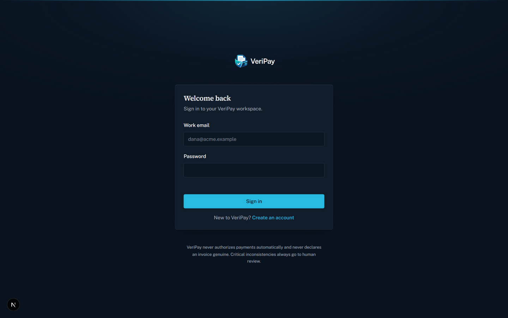

# VeriPay

<p align="center">
  
</p>

<p align="center">
  <strong>Explainable invoice-fraud review for finance &amp; procurement teams.</strong><br>
  VeriPay checks every invoice against independently verified vendor records,<br>
  explains what looks wrong, and routes the rest to humans.
</p>

<p align="center">
  <a href="https://github.com/ob3mor/VeriPay/actions/workflows/ci.yml">
    
  </a>
  
  
  
  
</p>

---

## What is VeriPay?

VeriPay ingests invoices and supporting documents, extracts fields with OCR, resolves
vendors, compares pay-to bank details against **independently verified** accounts on file,
computes **explainable** fraud signals, and routes critical inconsistencies to human
investigators with a full audit trail.

It is a **decision-support system, not a payment system**. Its output is evidence,
explanations, and review workflow — never money movement, and never a claim that an
invoice is genuine. Six invariants are normative for every design and code change:

> [!IMPORTANT]
> **The six invariants** (normative — [docs/ARCHITECTURE.md §2](docs/ARCHITECTURE.md#2-business-invariants-normative)):
> 1. Never authorize payments automatically.
> 2. Never claim an invoice is genuine.
> 3. Uncertain OCR must not become confident fraud evidence.
> 4. Missing records are not proof of fraud.
> 5. A new bank account requires independent verification.
> 6. Human review is mandatory for critical inconsistencies.

## Features

- **EVC fraud engine** — deterministic, explainable signals over six weighted features with
  per-feature uncertainty states and contributions; the result is a consistency measure, never a fraud probability.
- **Evidence retrieval** — citable evidence per invoice: purchase orders, bank accounts with
  verification status, vendor/invoice/document history; trust tiers, hybrid ranking, Arabic-Indic digit normalization.
- **Vendor & bank-account verification** — accounts start `pending`; only a human can approve,
  with a verification method + reference. Paying to an unverified account forces review.
- **Documents & OCR** — PDF/PNG/JPEG with magic-byte checks and dedup; extraction with evidence
  spans + confidence. Uncertain OCR becomes `unverified_input`, never evidence.
- **Investigations & audit** — critical findings auto-open cases that close only with a human
  outcome + resolution summary; append-only audit events with IP / request provenance.
- **Security model** — httpOnly cookie sessions + CSRF (zero tokens in web storage), four roles
  enforced per endpoint, org-scoped tenancy (cross-org is 404), bank-data masking.

## Screenshots


**Live overview.** Queue sizes come straight from the org-scoped stats API — and the page
itself reminds you that "nothing flagged" is never proof of correctness.


**Invoice triage.** Search, filter, and honest review states — every flagged invoice links
straight into its investigation.


**Investigation workspace.** Evidence, retrieval provenance, and explainable risk findings
side by side — every finding shows *why* it fired, and critical cases close only with a
human outcome.


**Vendor controls.** Bank accounts start pending; only a human, with an independent
verification record, can approve one. Tax IDs and account numbers are masked everywhere.


**Sign-in.** An httpOnly cookie session — no tokens in browser storage — with the safety
stance printed right on the page.

## Quickstart

Prerequisites: Python 3.12, Node 22+, npm 11. Windows cmd.exe is fine.

### 1. Backend — http://localhost:8000

From the repo root:

```bat
cd apps\api
python -m venv .venv
.venv\Scripts\pip install -e .[dev]

:: create the schema — REQUIRED once; the app does not create tables on startup
.venv\Scripts\python.exe -m alembic upgrade head

.venv\Scripts\python.exe -m uvicorn app.main:app --reload
```

(In PowerShell/bash, quote the extras: `pip install -e ".[dev]"`.)

Check: `curl http://localhost:8000/api/v1/health` → `{"status":"ok",...}`.
Interactive docs: `http://localhost:8000/docs`. Defaults are dev-safe (SQLite at
`apps\api\veripay.db`, local-filesystem document storage) — see [.env.example](.env.example).

### 2. Frontend — http://localhost:3000

```bat
npm install            :: from the repo root — installs all npm workspaces
cd apps\web
npm run dev
```

Open http://localhost:3000 → **Create an account** (registers your organization) → `/dashboard`.

Tests (from the repo root):

```bat
cd apps\api
.venv\Scripts\python.exe -m pytest -q
```

## Demo data

Load the synthetic demo dataset (12 invoices covering every fraud scenario, 3 investigation
cases) — run from `apps\api` so it seeds the same SQLite file the server uses:

```bat
cd apps\api
.venv\Scripts\python.exe ..\..\scripts\seed_demo.py
```

Idempotent — a re-run prints a note and exits 0. Then sign in at http://localhost:3000 with any of:

| Role | Email | Password |
|---|---|---|
| Organization Admin | `admin@demo.example` | `VeriPay-Demo-2026!` |
| Finance Officer | `finance@demo.example` | `VeriPay-Demo-2026!` |
| Reviewer | `reviewer@demo.example` | `VeriPay-Demo-2026!` |
| Auditor | `auditor@demo.example` | `VeriPay-Demo-2026!` |

Full screen-by-screen walkthrough: **[docs/DEMO_GUIDE.md](docs/DEMO_GUIDE.md)**.

## Architecture

```
  Next.js static export (apps/web)
        │  REST /api/v1 — cookie session (browser) · Bearer JWT (programs) · CSRF on mutations
  FastAPI modular monolith (apps/api)
        │                            │
  SQLAlchemy 2 (portable types)      StorageProvider · OcrProvider · ProcessingBackend seams
        │                            │
  PostgreSQL (canonical)             local filesystem (default) · MinIO/S3 (compose)
  SQLite (dev/test fallback)         Azure Blob (later) · inline processing (default) / Celery (optional)
```

One FastAPI service with enforced internal module boundaries and provider-agnostic adapter
seams. Design details, module dependency rules, and the 8-step workflow:
**[docs/ARCHITECTURE.md](docs/ARCHITECTURE.md)**.

### Repository layout

```
apps/api/                 FastAPI backend (app/, alembic/, tests/, pyproject.toml)
apps/web/                 Next.js static-export frontend (src/)
packages/api-contracts/   TypeScript mirrors of the REST contract (npm workspace)
infrastructure/local/     docker-compose.yml — postgres · MinIO · api · web (+ optional worker)
scripts/                  seed_demo.py, dev-up/dev-down helpers
docs/                     architecture, ADRs, runbooks, demo guide
```

## Documentation

| | Doc | What it covers |
|---|---|---|
| **Understand** | [docs/MASTER_PLAN.md](docs/MASTER_PLAN.md) | The phased master plan — what is built, what is next |
| | [docs/ARCHITECTURE.md](docs/ARCHITECTURE.md) | System design, module map, invariants, what is never automated |
| | [docs/DATABASE.md](docs/DATABASE.md) | Schema design (20 tables, canonical vocabulary v2) + migration contract |
| | [docs/API.md](docs/API.md) | REST contract (43 paths / 54 operations) + org-scoping rules |
| | [docs/IMPLEMENTATION_PLAN.md](docs/IMPLEMENTATION_PLAN.md) | Phase-by-phase implementation plan and recorded deviations |
| **Build & run** | [docs/DEMO_GUIDE.md](docs/DEMO_GUIDE.md) | Screen-by-screen demo walkthrough with talking points |
| | [docs/DEPLOYMENT_LOCAL.md](docs/DEPLOYMENT_LOCAL.md) | Docker compose runbook (local stack) |
| | [docs/TESTING.md](docs/TESTING.md) | Every verification command and its recorded output |
| **Operate** | [docs/SECURITY.md](docs/SECURITY.md) | Security model as implemented + honest open gaps |
| | [docs/LIMITATIONS.md](docs/LIMITATIONS.md) | What is verified vs. what is not — the honest boundary |
| | [docs/DEPLOYMENT_AZURE.md](docs/DEPLOYMENT_AZURE.md) | Azure demo deployment plan (plan-only, gated on approval) |
| | [docs/COST_ESTIMATE.md](docs/COST_ESTIMATE.md) | Azure cost analysis on a student budget (estimates, not bills) |
| | [docs/PREFLIGHT_AZURE.md](docs/PREFLIGHT_AZURE.md) | Read-only Azure pre-flight report + approval checklist |
| **Decisions (ADRs)** | [docs/adr/0001-modular-monolith.md](docs/adr/0001-modular-monolith.md) | One service, enforced internal module boundaries |
| | [docs/adr/0002-postgres-canonical-sqlite-dev-fallback.md](docs/adr/0002-postgres-canonical-sqlite-dev-fallback.md) | PostgreSQL canonical; SQLite dev/test fallback |
| | [docs/adr/0003-provider-agnostic-adapters.md](docs/adr/0003-provider-agnostic-adapters.md) | Storage / OCR / processing provider seams |
| | [docs/adr/0004-static-export-frontend.md](docs/adr/0004-static-export-frontend.md) | Next.js static export for free-tier hosting |
| | [docs/adr/0005-cookie-session-csrf.md](docs/adr/0005-cookie-session-csrf.md) | httpOnly cookie sessions + CSRF strategy |
| | [docs/adr/0006-processing-backends.md](docs/adr/0006-processing-backends.md) | Durable idempotent processing; inline default, Celery optional |
| | [docs/adr/0007-canonical-model-vocabulary-v2.md](docs/adr/0007-canonical-model-vocabulary-v2.md) | Canonical entity/table vocabulary (v2) |

## Status

**Built and locally verified** on the development machine (backend, frontend, contracts —
2026-10-17; test suite re-run 2026-10-18): the full backend (20-table schema, 43 REST paths),
the static-export frontend (14 routes), and the TypeScript contracts — **296 passed, 6 skipped**
(pytest, 2026-10-18) — plus migrations upgrade → downgrade → upgrade on a scratch DB, the
frontend build, and the contracts typecheck. [CI](https://github.com/ob3mor/VeriPay/actions/workflows/ci.yml)
re-runs the suite on SQLite **and** PostgreSQL 16 plus both builds on every push.

**Honest boundary — not done yet:** no Docker command has ever been executed anywhere (the
compose stack is code-inspected and YAML-parsed only); no cloud deployment exists — the Azure
profile is plan-only, gated on owner approval; OCR is text-layer + stub (Tesseract and Azure
Document Intelligence adapters are coded but not live). The full list:
**[docs/LIMITATIONS.md](docs/LIMITATIONS.md)**. Roadmap: **[docs/MASTER_PLAN.md](docs/MASTER_PLAN.md)**.

## Credits

Made by **Xander + Joka** 🛡️
